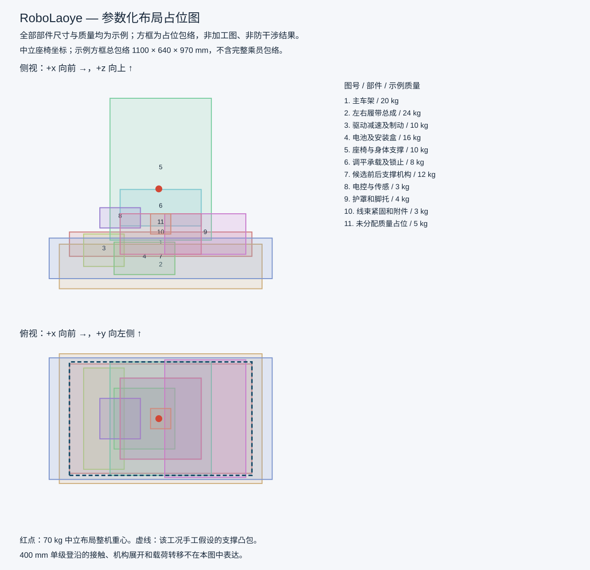
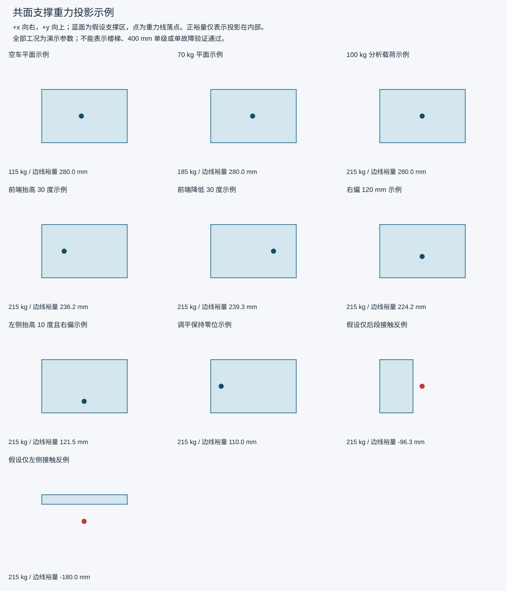

# 质量预算与共面支撑示例计算

由 simulation/layout_study.py 生成。全部布局尺寸、部件质量、人体重心、角度和接触点均为假设，不是实测或加工输入。

示例设备质量：**115 kg**；逐项假设上下限直接求和为 83–174 kg，非统计置信区间。重心结果只用名义质量，未对质量上下限求最坏组合。

## 质量表

| 部件 | 名义 kg | 假设范围 kg | 中立姿态重心 x/y/z mm |
|---|---:|---:|---|
| 主车架 | 20 | 16–26 | 0/0/250 |
| 左右履带总成 | 24 | 18–32 | 0/0/140 |
| 驱动减速及制动 | 10 | 8–16 | -280/0/220 |
| 电池及安装盒 | 16 | 12–22 | -80/0/180 |
| 座椅与身体支撑 | 10 | 8–15 | 0/0/620 |
| 调平承载及锁止 | 8 | 6–14 | 0/0/430 |
| 候选前后支撑机构 | 12 | 8–22 | 0/0/180 |
| 电控与传感 | 3 | 2–5 | -200/0/380 |
| 护罩和脚托 | 4 | 3–7 | 220/0/300 |
| 线束紧固和附件 | 3 | 2–5 | 0/0/300 |
| 未分配质量占位 | 5 | 0–10 | 0/0/350 |

## 示例工况

| 工况 | 总质量 kg | 重心 x/y/z mm | 重力落点 x/y mm | 最小有符号边线裕量 mm | 投影区域 |
|---|---:|---|---|---:|---|
| 空车平面示例 | 115 | -33.0/0.0/262.9 | -33.0/0.0 | 280.0 | 内部 |
| 70 kg 平面示例 | 185 | -9.2/0.0/522.9 | -9.2/0.0 | 280.0 | 内部 |
| 100 kg 分析载荷示例 | 215 | -3.7/0.0/582.5 | -3.7/0.0 | 280.0 | 内部 |
| 前端抬高 30 度示例 | 215 | 101.9/0.0/546.7 | -213.8/0.0 | 236.2 | 内部 |
| 前端降低 30 度示例 | 215 | -113.0/0.0/560.7 | 210.7/0.0 | 239.3 | 内部 |
| 右偏 120 mm 示例 | 215 | -3.7/-55.8/582.5 | -3.7/-55.8 | 224.2 | 内部 |
| 左侧抬高 10 度且右偏示例 | 215 | -3.7/-55.8/582.5 | -3.7/-158.5 | 121.5 | 内部 |
| 调平保持零位示例 | 215 | -3.7/0.0/582.5 | -340.0/0.0 | 110.0 | 内部 |
| 假设仅后段接触反例 | 215 | -3.7/0.0/582.5 | -3.7/0.0 | -96.3 | 外部 |
| 假设仅左侧接触反例 | 215 | -3.7/0.0/582.5 | -3.7/0.0 | -180.0 | 外部 |

正值仅表示重力落点位于给定支撑凸包内部；零值处于边界，负值在外部。该值是到各边延长线的最小有符号垂距，外部点处不等于到多边形的最短距离。没有设定合格裕量，也没有试验通过结论。

后段/单侧接触是手工构造的反例，并非从真实机构推导的故障工况。调平卡住仅改变座椅角度，未计算故障承载路径。

## 模型边界

只处理刚体、重力和 z=0 共面支撑点；忽略滑移、摩擦锥、驱动力、加减速、碰撞、变形及接触反力上限。座椅组绕固定铰点俯仰，乘员为一个集中质量。支撑面随底盘俯仰/侧倾；多层台阶接触不能投到此平面后直接套用。

用户已确认的 400 mm 单级高差不在这个求解器的适用范围内，尚未生成登沿可行性结论。门洞、电梯、平台净空与人体完整包络也未验证。

## 图示

## 输入追溯

- 布局输入文件 SHA-256: `4e658195ffda24e6479703103b94e486537e0f8cd37b1bda8c17c57453005020`
- 乘员及需求输入文件 SHA-256: `485d53039b0df68c5d2ebeb53e4d546d95cb642b97d7361b186bb7955aa9b670`

改变输入后重新运行生成器；正式模型需测量重心、导入机构运动学和真实接触，再单独完成动力/防滑/强度与故障保持分析。
